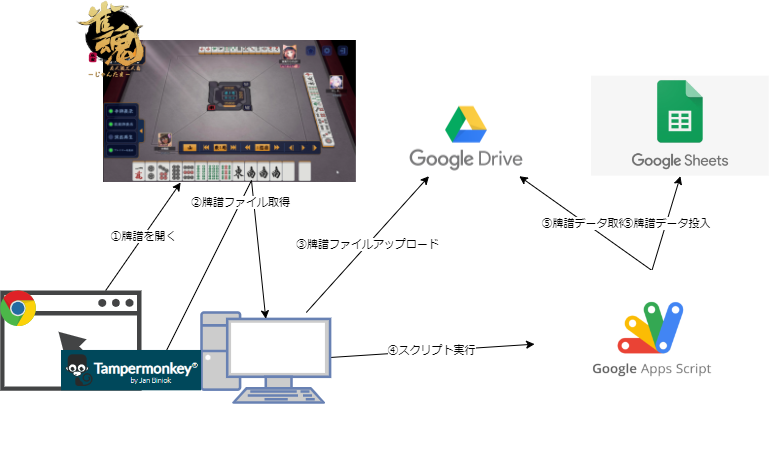

# JantamaRankingについて
友人戦の牌譜を集計してランキング形式にまとめる、という仕組みを作ったので公開します。全自動にできればよかったけど半自動です。  
元々はVtuberの [東風乃ちの](https://www.youtube.com/@c_chino_v) さんのメン限友人戦向けに作ったもので、そこの需要次第で適当にコードが変わったりするかもしれません。

## 全体像

#### 牌譜データを取ってくる
ブラウザの拡張機能（Tampermonkey）を使って、雀魂の画面から友人戦の牌譜データをファイルとして保存する。

#### 牌譜データをスプレッドシートに入れる
保存した牌譜データを Google Drive にアップロードし、スクリプトを動かして、スプレッドシートの試合結果シートにデータを入れる。

#### 集計する
スプレッドシートで好みに合わせて集計する（サンプルそのまんまでもOK）。

## 導入方法
準備中です。

## 開発
開発者向けの情報は `CLAUDE.md` と `docs/` にあります。
